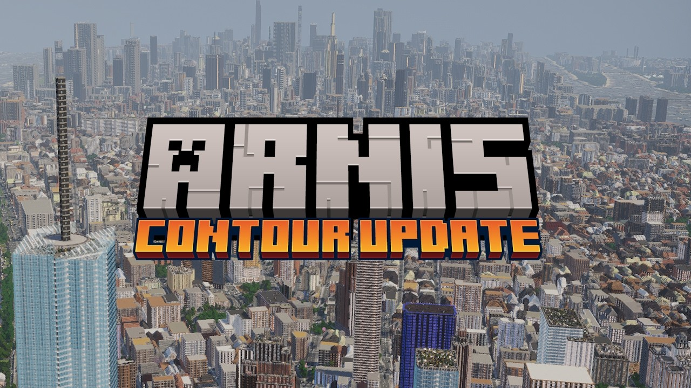
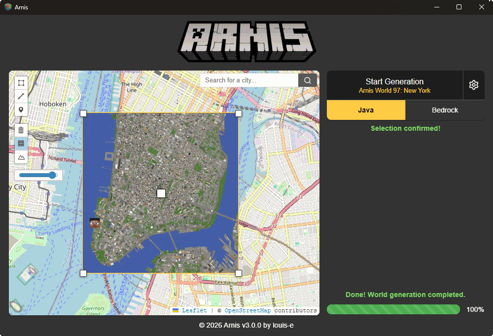

# Arnis Minecraft Maps from Real World Geography

Arnis Minecraft turns geographic data into playable worlds with recognizable streets, buildings, water, and terrain.
This Arnis MC overview covers the arnis minecraft generator and its world-generation workflow.
Both arnis minecraft bedrock exports and arnis minecraft java edition saves are available.

Arnis is developed by Louis Erbkamm and the upstream contributor community.
The desktop application runs on Windows, macOS, and Linux.
This repository pairs an Arnis overview with selected Tellus reference files, identified below.

[](https://arnis-minecraft.github.io/Arnis/)

## Features

A recognizable Minecraft landscape begins with geographic coverage and a suitable generation area.
Arnis converts mapped features into blocks and combines them with elevation information.

- Recreate a neighborhood, campus, landmark, or city district.
- Generate streets and buildings from geographic map features.
- Include waterways, vegetation, and terrain.
- Adjust scale and other generation settings for the intended build.
- Choose Java or Bedrock output for the target Minecraft edition.

| Component | Contribution to the world | What to inspect |
| --- | --- | --- |
| Building footprints | Position and outline of structures | Coverage and missing height information |
| Roads and paths | Street network and connections | Junctions and small passages |
| Water features | Rivers, lakes, and coastlines | Boundaries and terrain intersections |
| Elevation | Hills, valleys, and changes in ground level | Scale and available height range |
| Land cover | Distribution of natural surfaces | Regional detail and classification |
| Generation settings | Style, size, and optional detail | Compatibility with the destination edition |

The output reflects the source data and generation rules.
Mapped footprints do not guarantee an exact reconstruction of every facade or interior.



### World Settings

Arnis exposes generation options through its interface and command line.
Start with the intended edition, area, and scale before adding optional detail.

- Use a small selection to inspect the result before generating a larger region.
- Enable interiors when furnished buildings are useful to the project.
- Choose terrain-focused output when the landscape is the main subject.
- Set a spawn location that makes the selected area easy to explore.

For build-system reference, the supplied Tellus selection includes [settings.gradle](settings.gradle).
Its shared version properties are in [gradle.properties](gradle.properties).
Its project orchestration is in [build.gradle](build.gradle).

These Gradle settings belong to the reference mod; Arnis uses a separate Rust-based project.

## Usage

Select a real location using the map and rectangle selection tool.
Review the generation settings, choose the output edition, and start the generation.
Open the resulting world in the matching Minecraft edition after generation completes.

A useful first project is a compact area with several roads, buildings, and a recognizable landmark.
Compare those features with the map before expanding the selection.

The included Tellus interface references are [TellusClient.java](mc1201/src/client/java/com/yucareux/tellus/TellusClient.java) and [TerrainPreloadScreen.java](mc262-neoforge/src/client/java/com/yucareux/tellus/client/screen/TerrainPreloadScreen.java).
They illustrate a separate mod's client initialization and terrain-preload interface.

### Supported Minecraft versions

The [upstream Arnis README](https://github.com/louis-e/arnis/blob/main/README.md) currently lists Minecraft Java Edition 1.21.4 and later.
Bedrock exports use the Minecraft world package format.
Individual optional features can have additional version requirements.

| Destination | Generated result | Typical workflow |
| --- | --- | --- |
| Java Edition | A world directory | Open the generated save in Java Edition |
| Bedrock Edition | A .mcworld package | Import the package into Bedrock Edition |
| Mobile Bedrock | An imported Bedrock world | Transfer or download the package, then import it |

Arnis creates worlds without requiring a geographic terrain-generation mod in the Minecraft client.
Browser generation is offered separately through the MapSmith service.

The supplied reference metadata is [fabric.mod.json](mc1201/src/main/resources/fabric.mod.json) and [neoforge.mods.toml](mc1211-neoforge/src/main/resources/META-INF/neoforge.mods.toml).
Those files specify Tellus loader dependencies and do not define Arnis compatibility.

## Commands

The Arnis release executable supports command-line generation.
The following PowerShell example selects a small area in Amsterdam and exports a Java world:

```powershell
.\arnis-windows.exe --bbox="52.370,4.890,52.374,4.896" `
  --output-dir="./generated-worlds" `
  --scale=1.0
```

The bounding-box order is minimum latitude, minimum longitude, maximum latitude, maximum longitude.
The output directory receives the generated world.
Run this example from a directory containing the Arnis Windows executable.

For a Bedrock package, select the Bedrock output flag:

```powershell
.\arnis-windows.exe --bbox="52.370,4.890,52.374,4.896" `
  --output-dir="./generated-bedrock" `
  --bedrock
```

These commands are for Arnis and require its executable.
The supplied Tellus files do not provide that executable.

The reference mod's coordinate payload is [GeoTpTeleportPayload.java](mc1201/src/main/java/com/yucareux/tellus/network/GeoTpTeleportPayload.java).
Its map-opening payload is [GeoTpOpenMapPayload.java](mc1201/src/main/java/com/yucareux/tellus/network/GeoTpOpenMapPayload.java).
These are examples of geographic coordinates crossing a mod's network boundary.
The reference [ManagedTerrainStatusPayload.java](mc1201/src/main/java/com/yucareux/tellus/network/ManagedTerrainStatusPayload.java) carries terrain-download progress.

## Documentation

Use the [Arnis Wiki](https://github.com/louis-e/arnis/wiki) for generation settings and technical explanations.
The [Command Line Usage](https://github.com/louis-e/arnis/wiki/Command-Line-Usage) page documents available flags.

This independent Python example validates coordinate ordering and formats an Arnis bounding-box argument:

```python
south, west, north, east = 52.370, 4.890, 52.374, 4.896
if not (-90 <= south < north <= 90 and -180 <= west < east <= 180):
    raise ValueError("Expected an ordered geographic bounding box.")
bbox = ",".join(f"{value:.3f}" for value in (south, west, north, east))
print(f'--bbox="{bbox}"')
```

It uses only Python's standard language features and does not generate a world.
The example assumes the selected rectangle does not cross the antimeridian.



## Data Attribution

OpenStreetMap contributors provide an important part of the mapped geographic information.
Elevation datasets supply the terrain shape.
Dataset availability, resolution, and regional completeness affect the generated result.

Current Arnis documentation describes Mapterhorn elevation with an AWS Terrain Tiles fallback.
Consult the upstream data documentation for the sources used by a particular release.
Retain the applicable dataset attribution when distributing derived material.

The supplied Tellus tools offer related geographic-data references:

- [generate_mapterhorn_resolution_catalog.py](tools/generate_mapterhorn_resolution_catalog.py) builds a source-resolution catalog from Mapterhorn metadata.
- [build_resolve_lookup.py](tools/build_resolve_lookup.py) rasterizes ecoregion information into a compressed lookup.

Their output resources and dependencies belong to Tellus.

## Distant Horizons Integration

Distant-terrain rendering is a separate concern from producing a playable Arnis world.
Check the renderer's edition and version requirements when choosing a viewing setup.

The supplied Tellus compatibility materials include [sources.json](compat/distant-horizons/sources.json).
Its release verification helper is [verify_jars.py](compat/distant-horizons/verify_jars.py).
These files describe Tellus-specific Distant Horizons work and establish no Arnis integration requirement.

## Open Source

Arnis development separates geographic input processing from world generation and application interfaces.
The official project welcomes improvements to performance, usability, and documentation.

For comparison, the supplied Tellus build helpers are [tellus-fabric.gradle](gradle/tellus-fabric.gradle) and [tellus-neoforge.gradle](gradle/tellus-neoforge.gradle).
They configure distinct loader targets in the reference code.
This selected reference tree does not contain all shared sources required for a complete Tellus build.

### How to contribute

Describe the affected location, selected edition, generation settings, and observed behavior.
A small reproducible area is more useful than an unexplained large world.

- Include expected and actual results in a bug report.
- Distinguish missing map information from a generation defect.
- Identify the Arnis release used for the result.
- Explain the effect of a proposed code or documentation change.

## Known problems

Geographic coverage varies, so an unmapped feature may be absent from the world.
Large selections and detailed interiors can increase memory use and generation time.
The same visual options are not necessarily available in both output editions.

If a result looks incomplete, compare the selected area and source-map coverage first.
Then check the upstream documentation for edition limits and generation settings.

## Related Search Terms

Arnis Minecraft, Arnis MC, arnis minecraft generator, arnis minecraft bedrock, arnis minecraft java edition, minecraft, minecraft-world-generator, openstreetmap, osm, overpass-turbo, procedural-generation, rust, tauri, earth, generation
